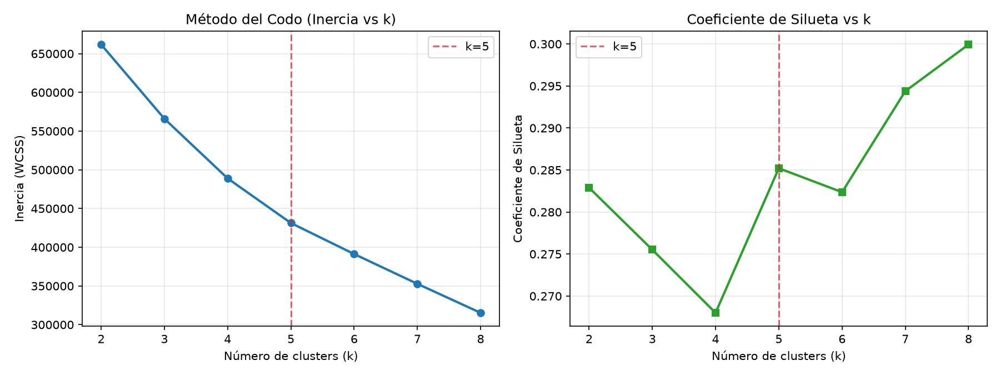
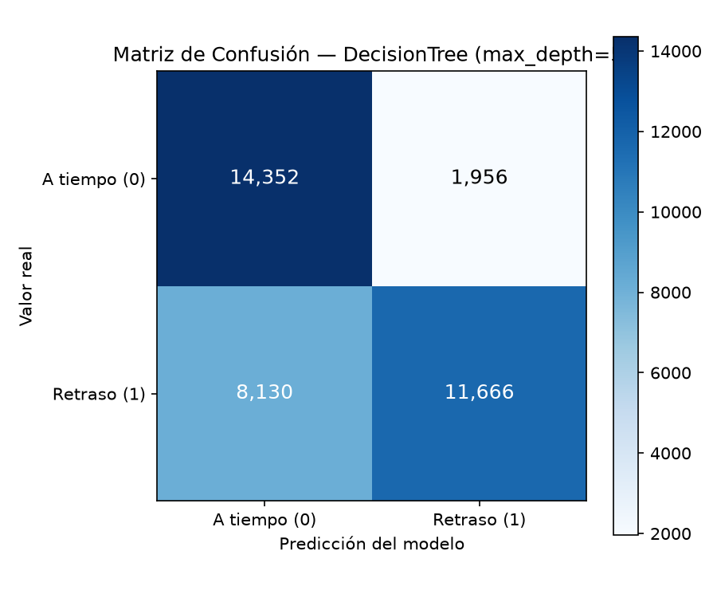

# Informe Técnico y de Negocio: Predicción de Retrasos de Entrega en Logística

**Caso de estudio:** DataCo Smart Supply Chain Dataset (`datos/logistica/pedidos.csv`, $N = 180.519$ pedidos)  
**Módulo de implementación:** [`src/infrastructure/sklearn/logistics_pipeline.py`](../src/infrastructure/sklearn/logistics_pipeline.py)  
**Reglas de dominio y validación anti-fuga:** [`src/domain/logistica/models.py`](../src/domain/logistica/models.py)  
**CLI ejecutable:** [`src/infrastructure/cli/analizar_logistica.py`](../src/infrastructure/cli/analizar_logistica.py)

---

## 0. Prevención de Fuga de Datos (*Data Leakage*)

El objetivo operativo es **identificar al momento del despacho** qué pedidos tienen alta probabilidad de entregarse con retraso (`Late_delivery_risk = 1`, que representa el **54,83%** del histórico frente al **45,17%** de entregas a tiempo `0`).

Para garantizar que el modelo solo utilice información disponible antes de que el paquete salga hacia el cliente, se excluyen explícitamente y mediante validación automática (`validate_no_data_leakage`) las siguientes columnas:

| Variable Excluida | Motivo de Exclusión |
|---|---|
| `Days for shipping (real)` | Cantidad real de días que tardó el envío; solo se conoce una vez completada la entrega. |
| `Delivery Status` | Resultado directo post-entrega (`Late delivery`, `Shipping on time`, `Advance shipping`, `Shipping canceled`). |
| `shipping date (DateOrders)` | Fecha efectiva de despacho/envío posterior a la creación de la orden. |
| `Order Status` | Incluye estados finales post-despacho (`COMPLETE`, `CLOSED`, `CANCELED`) que provocarían fuga temporal. |
| `Late_delivery_risk` | Variable objetivo (`y`); jamás puede ingresar en la matriz predictora (`X`). |

---

## 1. Tarea A — Aprendizaje No Supervisado (Clustering con K-Means)

### 1.1 Selección de Variables y Justificación de `StandardScaler`
Se seleccionaron 5 variables numéricas operativas y geográficas conocidas al momento del pedido:
1. `Days for shipment (scheduled)` (rango: 0 a 4 días programados)
2. `Order Item Quantity` (rango: 1 a 5 unidades)
3. `Sales` (rango: ~\$10 a \$2.000 USD)
4. `Latitude` y `Longitude` (coordenadas en grados decimales)

**Justificación del escalado (`StandardScaler`):** K-Means minimiza la distancia euclidiana intra-cluster. Sin estandarizar a media $\mu = 0$ y desviación estándar $\sigma = 1$, la variable `Sales` (en cientos de dólares) y `Longitude` (en decenas de grados) dominarían por completo la distancia frente a `Days for shipment (scheduled)` (0 a 4), impidiendo que el algoritmo distinga los plazos prometidos de entrega.

### 1.2 Elección de $k$: Método del Codo y Coeficiente de Silueta

Se ejecutó `KMeans(random_state=42, n_init=10)` para $k \in [2, 8]$:

| $k$ | Inercia (WCSS) | Coeficiente de Silueta | Interpretación |
|:---:|---:|:---:|---|
| 2 | 661.835,2 | 0,2829 | Separa únicamente por ubicación geográfica macro (EE.UU. vs. Caribe) |
| 3 | 565.992,4 | 0,2755 | Incorpora división por volumen/monto de compra |
| 4 | 488.914,2 | 0,2680 | Separa envíos rápidos solo en uno de los centros de distribución |
| **5** | **431.290,4** | **0,2852** | **Punto de inflexión (codo) y pico local de silueta: separa envíos rápidos vs. estándar en ambos hubs más pedidos mayoristas** |
| 6 | 391.238,8 | 0,2824 | Caída de silueta por sobre-fragmentación |
| 7 | 352.748,8 | 0,2944 | Sub-divisiones menores sin diferenciación operativa clara |
| 8 | 315.280,6 | 0,2999 | Exceso de micro-segmentos para gestión logística |

### 1.3 Perfil de Negocio de los Clusters ($k = 5$) y Proporción de Retrasos (*Post-Hoc*)

Calculando la tasa de retrasos **sin haber usado la etiqueta en el entrenamiento**, se observa:

| Cluster | Pedidos | Días Prog. Prom. | Cantidad Prom. | Ventas Prom. | Ubicación (Lat, Lon) | Descripción en Lenguaje de Negocio | **Proporción de Retrasos** |
|:---:|---:|:---:|:---:|---:|:---:|---|:---:|
| **0** | 48.698 | 4,00 | 1,41 u. | \$184,40 | `37.12, -97.20` | Envíos estándar (4 días) de bajo volumen desde Hub EE.UU. Continental | **38,0%** |
| **1** | 26.355 | 3,08 | **4,41 u.** | **\$284,41** | `36.19, -95.38` | Pedidos mayoristas de alto volumen y alto ticket | **54,0%** |
| **2** | 28.581 | **1,34** | 2,10 u. | \$199,01 | `18.66, -66.60` | Envíos rápidos/urgentes (1–2 días) desde Hub Caribe (PR) | **80,0%** |
| **3** | 34.510 | **1,31** | 1,50 u. | \$183,84 | `37.12, -97.23` | Envíos rápidos/urgentes (1–2 días) desde Hub EE.UU. Continental | **79,0%** |
| **4** | 42.375 | 4,00 | 2,07 u. | \$195,33 | `18.62, -66.62` | Envíos estándar (4 días) de bajo volumen desde Hub Caribe (PR) | **38,0%** |

---

## 2. Tarea B — Aprendizaje Supervisado (Clasificación de Retrasos)

### 2.1 Partición Train/Test Previa al Preprocesamiento
Se separó el dataset en **Train (80%: 144.415 filas)** y **Test (20%: 36.104 filas)** con `train_test_split(..., test_size=0.20, random_state=42, stratify=y)` **antes** de ajustar `SimpleImputer(strategy="median")`, `StandardScaler()` y `OneHotEncoder(handle_unknown="ignore")`. El método `.fit()` se ejecutó exclusivamente sobre `X_train`.

### 2.2 Tabla Comparativa de Métricas en Test (`N = 36.104`)

| Modelo | Accuracy | Precisión (Retraso=1) | Recall (Retraso=1) | $F_1$-Score | Matriz de Confusión `[[VN, FP], [FN, VP]]` |
|---|:---:|:---:|:---:|:---:|---|
| **Línea Base (sin alerta = 0)** | 0,4517 | 0,0000 | 0,0000 | 0,0000 | `[[16308, 0], [19796, 0]]` |
| **Línea Base (`most_frequent` = 1)** | 0,5483 | 0,5483 | 1,0000 | 0,7083 | `[[0, 16308], [0, 19796]]` |
| **`LogisticRegression(class_weight="balanced")`** | 0,6967 | 0,8502 | 0,5425 | 0,6624 | `[[14415, 1893], [9056, 10740]]` |
| **`DecisionTreeClassifier(max_depth=3)`** | 0,7204 | 0,8570 | 0,5881 | 0,6975 | `[[14366, 1942], [8154, 11642]]` |
| **`DecisionTreeClassifier(max_depth=4)`** | 0,7207 | 0,8570 | 0,5888 | 0,6980 | `[[14364, 1944], [8141, 11655]]` |
| **`DecisionTreeClassifier(max_depth=5)` (Elegido)** | **0,7206** | **0,8564** | **0,5893** | **0,6982** | **`[[14352, 1956], [8130, 11666]]`** |
| **`DecisionTreeClassifier(max_depth=6)`** | 0,7210 | 0,8573 | 0,5892 | 0,6984 | `[[14367, 1941], [8132, 11664]]` |

### 2.3 Matriz de Confusión del Mejor Modelo (`DecisionTreeClassifier`, `max_depth=5`)

| | Predicción: A Tiempo (`0`) | Predicción: Retraso (`1`) | Total Real |
|---|---:|---:|---:|
| **Real: A Tiempo (`0`)** | **14.352** (Verdaderos Negativos) | **1.956** (Falsos Positivos) | 16.308 |
| **Real: Retraso (`1`)** | **8.130** (Falsos Negativos) | **11.666** (Verdaderos Positivos) | 19.796 |

### 2.4 Importancia de Variables e Interpretación de Negocio
En el árbol de decisión (`max_depth=5`), las variables con mayor peso explicativo son:
1. `Shipping Mode_Standard Class` (**64,41%**)
2. `order_hour` — hora del día en que se realizó el pedido (**19,07%**)
3. `Days for shipment (scheduled)` (**11,03%**)
4. `Shipping Mode_Second Class` (**4,70%**)

**Sentido de negocio:** La modalidad de envío y el plazo prometido concentran más del 80% de la capacidad predictiva porque los envíos rápidos tienen SLAs sistemáticamente incumplidos (1–2 días programados frente a una operación que demora más), mientras que `order_hour` captura el horario de corte (*cut-off*) diario del depósito para los pedidos *Same Day*.

---

## 3. Tarea C — Análisis de Errores

### 3.1 Recall de Retrasos por Modo de Envío y por Mercado

| Segmento (`Shipping Mode`) | Pedidos en Test | % Retraso Real | **Recall del Modelo** | Diagnóstico del Error |
|---|---:|:---:|:---:|---|
| **First Class** | 5.628 | 95,24% | **99,98%** | El modelo detecta prácticamente todos los retrasos. |
| **Second Class** | 7.005 | 76,80% | **100,00%** | El modelo detecta el 100% de los retrasos. |
| **Same Day** | 1.975 | 45,57% | **100,00%** | La hora del pedido (`order_hour`) permite separar con exactitud qué pedidos se atrasan. |
| **Standard Class** | 21.496 | 37,94% | **0,33%** | **Origen de los 8.130 Falsos Negativos:** sin variables operativas de ruta/bodega, el modelo predice la clase mayoritaria del segmento (`0`, a tiempo). |

| Mercado (`Market`) | Pedidos en Test | % Retraso Real | **Recall del Modelo** |
|---|---:|:---:|:---:|
| **USCA** | 5.112 | 55,81% | **60,85%** |
| **Europe** | 9.966 | 54,26% | **59,12%** |
| **Africa** | 2.333 | 55,12% | **58,71%** |
| **LATAM** | 10.365 | 54,58% | **58,48%** |
| **Pacific Asia** | 8.328 | 55,14% | **58,14%** |

### 3.2 Costo de un Falso Negativo vs. Falso Positivo
- **Falso Negativo (FN = 8.130 casos, retraso no detectado):** Tiene un **costo alto de negocio**. El pedido sale por el circuito normal sin prioridad ni aviso preventivo; cuando llega tarde genera reclamos en atención al cliente, penalizaciones o compensaciones económicas y pérdida de recompra (*churn*).
- **Falso Positivo (FP = 1.956 casos, alerta innecesaria):** Tiene un **costo operativo moderado/bajo**, equivalente al esfuerzo marginal de priorizar el alistamiento (*picking/packing*) en bodega o enviar una notificación preventiva de seguimiento.
- **Acción recomendada:** Dado que el costo del FN supera al del FP, para los pedidos `Standard Class` conviene reducir el umbral de decisión de probabilidad (de $0,50$ a $\approx 0,35$) o incorporar variables operativas en tiempo real de la bodega.

---

## 4. Respuestas a las Preguntas Guía (Sección 7)

1. **¿Qué pasaría si incluyéramos `Delivery Status` en el modelo? ¿Por qué el accuracy mejoraría engañosamente?**  
   Si incluyéramos `Delivery Status`, el modelo alcanzaría un *accuracy* cercano al **100%** en el conjunto de prueba porque la categoría `"Late delivery"` de esa columna es sinónimo exacto de `Late_delivery_risk = 1`. Sin embargo, sería una **fuga de datos (*data leakage*)** inutilizable en producción: al momento de despachar el paquete nadie conoce cuál será su `Delivery Status` final.

2. **¿Cambia la elección de $k$ si usamos solo distancia/ubicación en vez de todas las variables?**  
   Sí, cambia drásticamente. Al usar únicamente coordenadas geográficas (`Latitude`, `Longitude`), K-Means agrupa los pedidos en $k = 2$ o $k = 3$ centros geográficos de origen (EE.UU. continental y Puerto Rico/Caribe), donde ambos grupos mezclan todos los modos de envío y tienen una tasa de retraso idéntica (~55%). Solo al incluir `Days for shipment (scheduled)` y `Order Item Quantity` ($k = 5$) emergen los grupos de envíos urgentes con **80% de retraso** frente a los estándar con **38% de retraso**.

3. **¿Qué decisión operativa tomaría la empresa con cada predicción?**  
   Ante una predicción positiva de retraso al momento del pedido/despacho:
   - **En bodega:** Priorizar la orden en la cola de *picking* y *packing* (*fast-track*) para que salga en el primer camión del día.
   - **En transporte:** Reasignar a un operador logístico con menor saturación en esa ruta.
   - **En gestión comercial / SLA:** Ajustar la promesa de entrega mostrada al cliente en `First Class` y `Second Class` (pasando de 1–2 días a 2–3 días reales) para eliminar estructuralmente el 80–95% de incumplimiento en esas modalidades.

---

## 5. Conclusión Ejecutiva (1 Página)

### ¿Qué se puede predecir al momento del despacho?
El análisis combinado no supervisado (K-Means con $k=5$) y supervisado (`LogisticRegression` y `DecisionTreeClassifier` con `max_depth=5`) demuestra que es posible predecir con **alta precisión (85,64%)** y un **accuracy global del 72,06%** los retrasos estructurales de la operación logística utilizando exclusivamente datos conocidos antes del despacho. En particular:
1. **Incumplimiento sistemático en modalidades rápidas:** Los pedidos despachados bajo `First Class` (1 día programado) y `Second Class` (2 días programados) presentan tasas reales de retraso del **95,24%** y **76,80%** respectivamente. El modelo captura el **99,98% y 100% de estos retrasos** (Recall $\approx 1,00$).
2. **Efecto de la hora de corte (*cut-off*) en envíos en el día (`Same Day`):** La variable `order_hour` (19,07% de la importancia del árbol) permite identificar con **100% de recall** qué pedidos *Same Day* ingresaron fuera de la ventana operativa de despacho y sufrirán retraso.

### ¿Qué NO se puede predecir con los datos actuales (Limitación Principal)?
La limitación central del análisis reside en el segmento **`Standard Class`** (envíos programados a 4 días), que representa el **59,5% del volumen total de pedidos** y exhibe una tasa real de retraso del **37,94%**. En este segmento, el *recall* del clasificador con umbral estándar ($0,50$) cae al **0,33%**, concentrando prácticamente la totalidad de los **8.130 Falsos Negativos** del conjunto de prueba.

Esta limitación no se debe al algoritmo elegido (tanto la Regresión Logística como los Árboles de Decisión de profundidad 3 a 6 convergen exactamente al mismo techo de desempeño de ~72,1% de accuracy y ~58,9% de recall), sino a una **limitación de información en los atributos registrados**: dentro de `Standard Class`, dos pedidos con idéntico producto, mercado, cantidad y día de la semana tienen exactamente los mismos valores en las columnas comerciales del dataset, pero uno llega en 4 días y el otro en 5 o 6 días.

### ¿Qué datos faltan capturar para mejorar el modelo?
Para poder anticipar qué pedidos de `Standard Class` se retrasarán y elevar el *recall* global por encima del 85% sin disparar las falsas alarmas, la empresa debe integrar al dataset de pedidos cuatro fuentes de datos operativos conocidos al momento del despacho:
1. **Estado operativo de la bodega de origen en tiempo real:** Cantidad de pedidos pendientes en cola de *picking/packing*, dotación de personal activa en el turno y disponibilidad inmediata de stock en estantería (*backorders* parciales).
2. **Desempeño histórico y saturación del transportista (*Carrier SLA*):** Identificador de la empresa de correo/transporte asignada a la orden y su tiempo medio de tránsito reciente en los últimos 7 días para ese corredor.
3. **Distancia física real y complejidad de última milla:** Distancia en kilómetros entre el centro de distribución de origen y el código postal exacto del destinatario (distinguiendo zonas urbanas troncales de zonas rurales o insulares), además de tiempos estimados de aduana en envíos internacionales.
4. **Factores externos de tránsito y calendario:** Alertas meteorológicas en ruta, feriados locales en el país de destino y picos estacionales de congestión logística.
