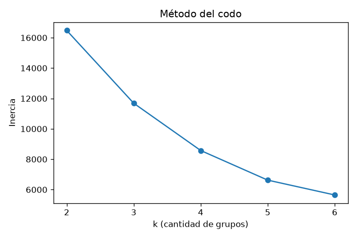
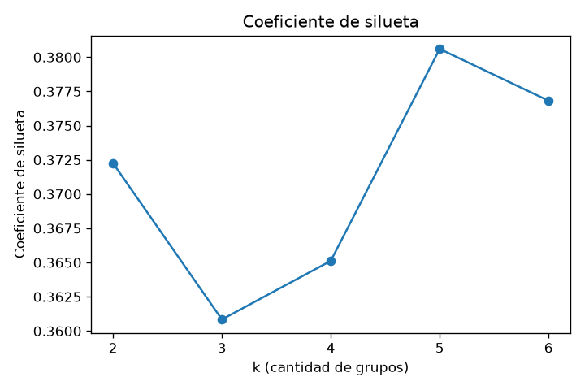

# Conclusión — Anticipación de episodios de alta contaminación por CO

> **Issue [#7](https://github.com/datamaq-automation/energy-ml/issues/7)** · Tareas A, B y C ·
> Reproducir todo con: `python -m src.medioambiente`

## Qué aviso emitir

Emitir una **alerta horaria de contaminación** cuando el **árbol de decisión**
(`max_depth` elegido por CV, mejor F1 de los tres modelos) prediga
`episodio = 1`, es decir `CO(GT) ≥ 2,5 mg/m³` en la hora siguiente.
Con el split temporal —el único que simula un aviso real— el modelo alcanza
**precisión 0,625, recall 0,648 y F1 0,636**: de cada 100 alertas, ~63 serán
episodios reales y se detectará ~65 % de los episodios
(matriz `[[939, 167], [151, 278]]` sobre 1.535 horas de test).

## Con qué anticipación

**1 hora.** Las features son la meteorología de las horas **t-1 y t-2** (por
reloj, jamás la hora simultánea) más el calendario de la hora a predecir: al
cerrar la hora t-1 ya se emite el aviso para la hora t. Cero fuga de datos:
ni `CO(GT)` ni los sensores (`PT08.*`, `NOx`, `NO2`, `NMHC`, `C6H6`) entran
como entrada; el imputador y el escalador se ajustan **solo en train**.

## Resultados principales

| modelo | split | accuracy | precision | recall | F1 |
|---|---|---|---|---|---|
| línea base | aleatorio | 0,668 | 0,000 | 0,000 | 0,000 |
| regresión logística | aleatorio | 0,680 | 0,513 | 0,684 | 0,586 |
| **árbol** | **aleatorio** | **0,805** | **0,712** | **0,690** | **0,701** |
| línea base | temporal | 0,721 | 0,000 | 0,000 | 0,000 |
| regresión logística | temporal | 0,696 | 0,470 | 0,678 | 0,555 |
| **árbol** | **temporal** | **0,793** | **0,625** | **0,648** | **0,636** |

- **Tarea A (sin etiqueta):** k = 5 por silueta (0,381; k=2..6 entre 0,361 y
  0,381) — grupos: templado-cálido húmedo, templado seco, caluroso muy seco,
  fresco húmedo y frío seco. La proporción de episodios por grupo va de
  26,8 % a 35,7 %.
- **Tarea C:** el split aleatorio **infla** las métricas (F1 0,701 → 0,636):
  filas de la misma semana quedan de ambos lados y el modelo "recuerda" la
  semana. Solo el split temporal (train 2004-03-10 → 2005-01-29, test
  2005-01-29 → 2005-04-04) es honesto para un aviso.

**Gráficos de la Tarea A (entregable):**

## Discusión: ¿y si se entrena en invierno y se usa en verano?

El modelo aprende la relación meteo→CO de un período concreto; si la
distribución de las features cambia, esa relación deja de valer y el aviso
se degrada (más falsas alarmas o episodios perdidos). Para detectarlo,
`detectar_cambio_distribucion()` compara la media de cada feature entre
entrenamiento y uso con desviación estandarizada: en nuestro split marcó
`T_t1`, `T_t2`, `AH_t1`, `AH_t2` y `mes` (T cae de 19,5 °C a 10,7 °C,
−1,04σ). **Propuesta:** monitorear ese indicador en producción y reentrenar
cuando alguna feature supere 0,5σ de desplazamiento.

## Limitaciones

1. **Un solo lugar y un solo año** (Italia, 2004-05): no hay garantía de
   generalización a otra ciudad o clima.
2. **Umbral pedagógico** (2,5 mg/m³), no normativo; cambiarlo altera la
   dificultad del problema.
3. **Estructura de grupos débil** en la Tarea A (siluetas 0,36-0,38): los
   datos no forman agrupamientos naturales nítidos.
4. **Recall 0,648:** ~35 % de los episodios quedan sin detectar con el
   mejor modelo sobre test temporal.
5. **Cambio estacional detectado** (invierno → primavera): el modelo puede
   degradarse fuera de la temporada de entrenamiento (ver discusión).
6. **1.683 horas descartadas** por `CO(GT)` faltante; la etiqueta no existe
   para ellas.
7. **Anticipación acotada a 1 hora** (t-1/t-2); avisos con más margen
   requerirían features de días previos o pronóstico.

## Checklist de aceptación (sección 6 del issue)

- [x] Ningún sensor de la misma hora ni `CO(GT)` en `X_train`/`X_test`
       (`COLUMNAS_PROHIBIDAS`, test `test_flujo_real_sin_fuga_en_x_train_y_x_test`)
- [x] `-200` no aparece en los datos tras la limpieza
- [x] Split de la Tarea B estratificado y hecho antes de transformar
- [x] Tarea C usa split temporal (test posterior al train)
- [x] Precisión, recall, F1 y matriz de confusión sobre "episodio"
- [x] `ruff check` y `pytest` pasan

**Entregables:** módulo con A→B→C en orden (`python -m src.medioambiente`),
tabla de métricas (arriba), matriz del árbol sobre test temporal
(`[[939, 167], [151, 278]]`), gráficos de codo y silueta (arriba) y esta
conclusión.
