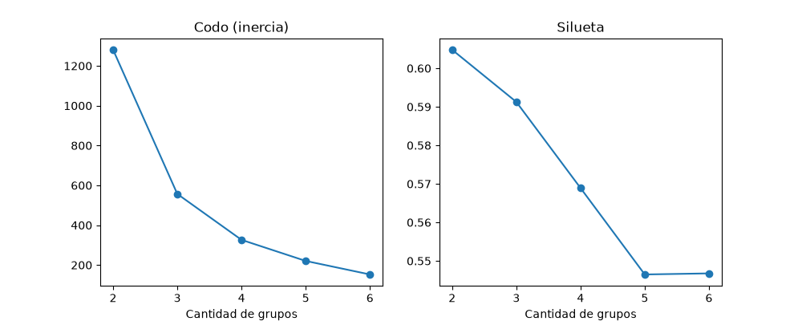
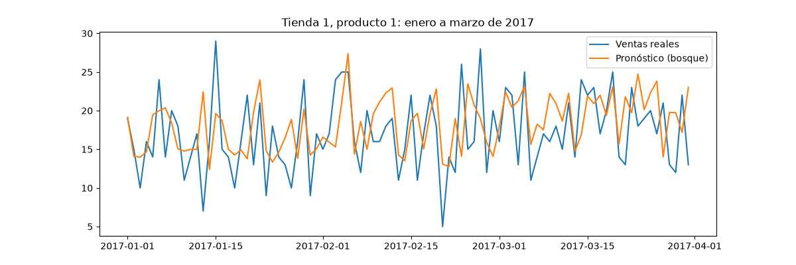

# Cuaderno de trabajo — Pronóstico de ventas (Issue #2)

## Plan de 5 pasos

1. Conseguir los datos ✅
2. Mirar los datos ✅
3. Agrupar productos parecidos ✅
4. Pronosticar las ventas y comparar ⏳ (en curso)
5. Sacar conclusiones

---

## Los dos tipos de machine learning (ML) del trabajo

| | Paso 3: agrupar | Paso 4: pronosticar |
| --- | --- | --- |
| Tipo de ML | **No supervisado** | **Supervisado** |
| Qué hace | Junta productos parecidos en grupos | Adivina las ventas de mañana |
| ¿Tiene respuestas para aprender? | **No**: la computadora encuentra los grupos sola | **Sí**: aprende de las ventas reales del pasado |
| Herramienta | K-means | Regresión lineal y bosque aleatorio |
| Ejemplo | Ordenar un placard en pilas | Decir "mañana voy a vender 20" y después comparar |

---

## Paso 1 — Conseguir los datos

- Fuente: Kaggle, "Store Item Demand Forecasting".
- Archivo: `datos/ventas/demanda.csv`.

## Paso 2 — Mirar los datos

**Columnas de la planilla:**

- `date` → el día
- `store` → la tienda
- `item` → el producto
- `sales` → cuántas unidades se vendieron

Ejemplo: el 2 de enero de 2013, la tienda 1 vendió 11 unidades del producto 1.

**Lo que descubrimos:**

- 913.001 renglones = 1 renglón de títulos + **913.000 registros**.
- Cada registro es: un día, en una tienda, de un producto.
- Fechas: desde el **1/1/2013** hasta el **31/12/2017** (5 años).
- **10 tiendas** y **50 productos** → 10 × 50 = **500 combinaciones**.
- 5 años = 1.826 días (2016 fue bisiesto).
- 500 × 1.826 = 913.000 → coincide: **no falta ningún día**. Los datos están completos.

**Comandos que usamos:**

- `head datos/ventas/demanda.csv` → ver los primeros renglones.
- `wc -l datos/ventas/demanda.csv` → contar renglones (no suma unidades).
- Python para ver la primera y última fecha, y contar tiendas y productos.

## Paso 3 — Agrupar productos parecidos (Tarea A)

**La idea:** para cada una de las 500 combinaciones (tienda + producto) armamos una **ficha** con:

- cuánto vende en promedio por día,
- cuánto cambia de un día a otro,
- qué días de la semana vende más.

Después la computadora junta las fichas parecidas en grupos (como ordenar un placard). Un producto que vende 50 por día y otro que vende 5 van en grupos distintos.

**Archivo:** `ventas/agrupar.py`

**Lo que hicimos:**

- Leímos la planilla con Python (`pandas`) y comprobamos que tiene 913.000 registros.
- Calculamos el **promedio de ventas por día** de cada tienda + producto, con `groupby` (parecido a una tabla dinámica de Excel).
- Ejemplo: la tienda 1 vende en promedio 20 unidades por día del producto 1, y 53 del producto 2.

- Agregamos el **desvío** (`std`): mide si un producto vende **parejo** o **variable**. Ejemplo del kiosco: A vende 10, 10, 10, 10 (parejo, fácil de adivinar); B vende 0, 20, 5, 15 (variable, difícil). Los dos promedian 10.
- Resultado: la tienda 1, producto 2 vende 53 por día con desvío 15 (el más variable de los 5 primeros; también el que más vende).
- Fichas de los primeros 5 productos de la tienda 1 (se calcularon las 500):

| Producto | Promedio por día | Desvío |
| :------: | ---------------: | -----: |
|    1     |               20 |    6,7 |
|    2     |               53 |   15,0 |
|    3     |               33 |   10,1 |
|    4     |               20 |    6,6 |
|    5     |               17 |    5,7 |

- Agregamos **días sin venta** (`sin_venta`): qué parte de los días vendió cero. Ejemplo: la leche se vende todos los días (casi nunca tiene días sin venta); los fósforos tienen muchos días sin venta (producto **esporádico**).
- **Descubrimiento:** en los 913.000 registros hay **un solo día** con venta cero. Todos los productos son "como la leche": **no hay productos esporádicos**. Esta columna no sirve para separar grupos, porque da casi lo mismo en todos.
- Agregamos **qué días de la semana vende más**. Python numera los días desde 0: 0 = lunes … 6 = domingo.
- Promedio de ventas por día (todas las tiendas y productos juntos):

| Día | Promedio |
| :-------- | -------: |
| lunes     |       41 |
| martes    |       48 |
| miércoles |       48 |
| jueves    |       52 |
| viernes   |       55 |
| sábado    |       59 |
| domingo   |       62 |

- **Descubrimiento:** las ventas **suben a lo largo de la semana**: el lunes es el día más bajo y el domingo el más alto. (Mi idea era "sábado más, lunes menos": acerté con el lunes).
- Ejemplo por ficha: la tienda 1 vende del producto 1 unas 16 unidades los lunes y 24 los domingos.
- **La ficha quedó completa:** 10 columnas por cada tienda + producto → promedio, desvío, días sin venta y los 7 días de la semana.
- Les pusimos nombre a las columnas de los días (`rename`: 0 → lun, 1 → mar, …) y mostramos los números **redondeados** solo para leer más fácil (los cálculos usan los números completos).
- Así quedó la ficha (primeros 5 productos de la tienda 1):

| Producto | Promedio | Desvío | Sin venta | lun | mar | mié | jue | vie | sáb | dom |
| :------: | -------: | -----: | --------: | --: | --: | --: | --: | --: | --: | --: |
|    1     |       20 |      7 |         0 |  16 |  18 |  19 |  19 |  21 |  23 |  24 |
|    2     |       53 |     15 |         0 |  42 |  49 |  50 |  53 |  56 |  60 |  63 |
|    3     |       33 |     10 |         0 |  27 |  30 |  31 |  33 |  35 |  37 |  40 |
|    4     |       20 |      7 |         0 |  15 |  18 |  18 |  20 |  21 |  23 |  24 |
|    5     |       17 |      6 |         0 |  13 |  15 |  16 |  17 |  17 |  19 |  20 |

- **Escalar** (`StandardScaler`): poner todas las columnas en la **misma regla** para que pesen igual. Ejemplo: si agrupo empleados por sueldo (800.000) y antigüedad (10), sin escalar la computadora ignora la antigüedad. Después de escalar, 0 = como el promedio, negativo = vende menos, positivo = vende más.
- Dejamos afuera la columna `sin_venta`, porque da 0 en casi todos y no ayuda a separar.

### ¿Cuántos grupos armar?

Probamos con 2, 3, 4, 5 y 6 grupos (K-means, `random_state=42`) y miramos 2 notas:

- **Inercia** (gráfico del **codo**): qué tan lejos quedan los productos del centro de su grupo. Más baja = grupos más prolijos.
- **Silueta**: nota de 0 a 1, como un porcentaje. Más cerca de 1 = grupos mejor separados.

| Grupos | Inercia | Silueta |
| :----: | ------: | ------: |
|   2    |    1281 |    0,60 |
|   3    |     557 |    0,59 |
|   4    |     326 |    0,57 |
|   5    |     220 |    0,55 |
|   6    |     153 |    0,55 |

Gráficos: `ventas/codo_silueta.png`

**Elegimos 3 grupos.** De 2 a 3 grupos la inercia baja muchísimo; desde 3 en adelante baja poco (ahí "se dobla el codo"). Es como limpiar una casa: sumar la segunda persona ahorra mucho tiempo, pero la cuarta casi nada. Y la silueta con 3 grupos (0,59) es casi igual a la más alta (0,60).

### Los 3 grupos

La computadora armó los 3 grupos (K-means con `n_clusters=3`). Cada ficha (tienda + producto) quedó con una etiqueta: grupo 0, 1 o 2.

| Grupo | Nombre | Fichas | Promedio por día | Desvío | lun | dom |
| :---: | :----------- | -----: | ---------------: | -----: | --: | --: |
|   0   | Ventas altas |    122 |               86 |     23 |  68 | 102 |
|   1   | Ventas medias |   183 |               55 |     15 |  44 |  66 |
|   2   | Ventas bajas |    195 |               28 |      9 |  22 |  34 |

122 + 183 + 195 = 500 fichas.

**Descripción para un gerente:**

- **Ventas altas:** los productos estrella. Venden unas 86 unidades por día y son los que más cambian de un día a otro.
- **Ventas medias:** venden unas 55 por día.
- **Ventas bajas:** venden unas 28 por día y son los más parejos.
- En los 3 grupos las ventas **suben de lunes a domingo**: lo que separa a los grupos es **cuánto venden**, no qué día venden.

**Descubrimiento sobre las tiendas:** el grupo de ventas altas no tiene fichas de las tiendas **5, 6 y 7**. Son las tiendas que menos venden (36 a 40 por día en promedio, contra 67 de la tienda 2). Seguramente son tiendas más chicas o con menos gente.

### ¿Conviene una forma distinta de pronosticar para cada grupo?

**Mi opinión: no hace falta.** Los 3 grupos tienen el **mismo comportamiento** (suben de lunes a domingo); solo cambia **cuánto** venden. Es como cocinar la **misma receta** en 3 ollas de distinto tamaño: no hacen falta 3 recetas.

Igual lo vamos a **comprobar** en la Tarea C: mirar si el pronóstico se equivoca más en algún grupo (por ejemplo, en ventas altas, que son las que más cambian de un día a otro).

**✅ Tarea A terminada.**

- Un *Warning* en inglés es un **aviso**, no un error: `dayofweek` se reemplazó por `day_of_week`.
- Aprendimos a leer un error: `SyntaxError: '(' was never closed` en la línea 7 = faltaba cerrar un paréntesis.

**Cómo leer el resultado:** el número de tienda aparece una sola vez; los espacios vacíos debajo significan "sigue siendo la misma tienda" (como una celda combinada).

**Pendiente:** nada en este paso. Sigue el paso 4 (Tarea B).

---

## Paso 4 — Pronosticar las ventas y comparar (Tarea B)

**Archivo:** `ventas/pronosticar.py`

**Separar por tiempo (no al azar):**

- **Aprender:** 2013 a 2016 → 730.500 registros 📚
- **Examen:** 2017 → 182.500 registros (500 fichas × 365 días) 📝

¿Por qué no días al azar? Porque en la vida real solo conocemos el pasado. Si mezcláramos, para adivinar un miércoles la computadora podría haber visto el martes y el jueves de esa semana: sería espiar el futuro y la nota saldría mejor de lo que es.

**Pistas que usa la computadora** (todas de días anteriores, calculadas dentro de cada tienda + producto):

- `ayer` → lo que vendió el día anterior (`shift(1)`)
- `semana_pasada` → lo que vendió el mismo día de la semana anterior (`shift(7)`)
- `dia` → día de la semana (0 = lunes … 6 = domingo)
- `mes` → mes del año (1 a 12)

Importante: primero **ordenar** por tienda, producto y fecha; si no, "ayer" no sería ayer.

**Los 3 métodos:**

1. **Igual que ayer** (línea base): "mañana vendo lo mismo que hoy". Es la nota a superar.
2. **Regresión lineal:** la computadora arma **una fórmula** que mezcla las 4 pistas ("un poco de ayer + un poco de la semana pasada + un extra según el día y el mes").
3. **Bosque aleatorio:** **200 árboles de preguntas** ("¿es domingo? ¿ayer vendió más de 50?") y promedia lo que dice cada uno, como preguntarle a 200 personas. Usamos `random_state=42` y `min_samples_leaf=50` (cada respuesta se basa en al menos 50 días, para que no memorice casos raros y no se tilde la computadora).

**Cuánto se equivoca cada uno en 2017** (error absoluto medio, MAE):

| Método | MAE (error promedio) | RMSE (castiga errores grandes) |
| :--------------- | -------------------: | -----------------------------: |
| Igual que ayer   |                 11,2 |                           15,4 |
| Regresión lineal |                  8,0 |                           10,4 |
| Bosque aleatorio |              **7,4** |                        **9,6** |

**MAE:** cuántas unidades se equivoca en promedio por día.
**RMSE:** otra nota que castiga más los errores grandes. Ejemplo: Ana se equivoca por 2 todos los días; Beto acierta 9 días pero un día se equivoca por 20 (vacía la góndola). En promedio se equivocan igual, pero con RMSE Beto sale peor.

**Conclusión:** el bosque aleatorio gana en las dos notas. Los dos métodos de ML le ganan a "igual que ayer". La regresión lineal queda cerca del bosque y es más simple y rápida.

Para comparar: en promedio cada ficha vende unas 53 unidades por día. "Igual que ayer" se equivoca más o menos en 1 de cada 5 unidades.

### Gráfico: ventas reales contra pronóstico

Tienda 1, producto 1, enero a marzo de 2017: `ventas/real_vs_pronostico.png`

**Qué se ve:** la línea del pronóstico (naranja) va **por el medio** de las ventas reales (azul). Acierta el **nivel general** (15 a 20 por día), pero **no adivina los picos** (el día que vendió 29 o el que vendió 5). Esos picos son sorpresas que no se pueden saber mirando el pasado. Para un negocio igual sirve: dice cuánto pedir para un día normal.

**Por qué el RMSE de "igual que ayer" es mucho más alto que su MAE:** porque algunos días se equivoca por mucho. Ejemplo: el domingo vende 62, la regla dice "el lunes vendo 62", pero el lunes vende 41 → error de 21.

**¿Qué método usaría como gerente?** El bosque aleatorio, porque es el que menos se equivoca (menos mercadería que sobra y menos ventas perdidas). La regresión lineal también sería una buena opción: queda cerca y es más simple.

**✅ Tarea B terminada.**

## Tarea C — ¿En qué grupo se equivoca más?

Guardamos los grupos de `agrupar.py` en `ventas/grupos.csv` (tienda, producto, grupo) y en `pronosticar.py` los pegamos a cada venta con `merge` (como un BUSCARV de Excel).

**Error promedio (MAE) en 2017, por grupo:**

| Grupo | Vende por día | Igual que ayer | Lineal | Bosque | Error del bosque en proporción |
| :------------ | ----: | ---: | ---: | ---: | ------: |
| Ventas altas  |    97 | 16,3 | 10,9 |  9,9 | **10%** |
| Ventas medias |    62 | 11,9 |  8,4 |  7,8 | **12%** |
| Ventas bajas  |    32 |  7,5 |  5,8 |  5,5 | **17%** |

- En **unidades**, se equivoca más en ventas **altas** (10 unidades).
- Pero en **proporción**, el más difícil es ventas **bajas** (17%). Es como equivocarse por $10 en una compra de $100 (poco) o por $5 en una compra de $30 (mucho más).
- En ventas bajas es donde el bosque **menos le gana** a "igual que ayer": baja el error un 27%, contra 40% en ventas altas.

**Hipótesis:** cuando un producto vende poco, cada cliente pesa mucho. En un kiosco que vende 100 cafés, 1 cliente más casi no se nota; en uno que vende 5, 1 cliente más es un 20% más. En los productos de pocas ventas manda más el **azar** (quién pasa ese día) que los patrones (día de la semana, mes), y el azar no se puede adivinar.

**✅ Tarea C terminada.**

---

## Reglas importantes (para el paso 4)

**Fuga de datos = hacer trampa.** Para adivinar las ventas de un día solo se pueden usar datos de días **anteriores**.

Ejemplo del kiosco: para probar si adivino bien las ventas del miércoles, tapo el miércoles con la mano y miro solo lunes y martes. Después destapo y comparo.

Que los datos sean viejos no evita la trampa: igual hay que "tapar" los días que queremos adivinar.
